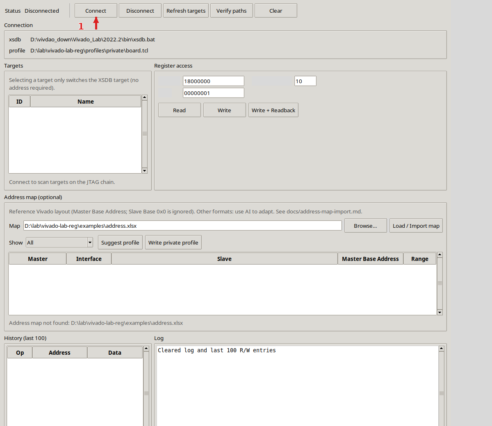
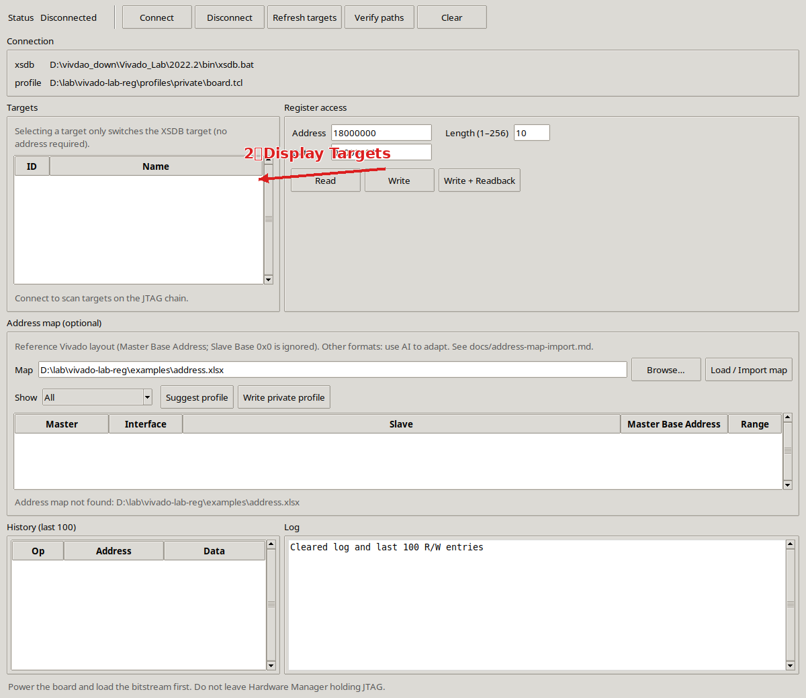
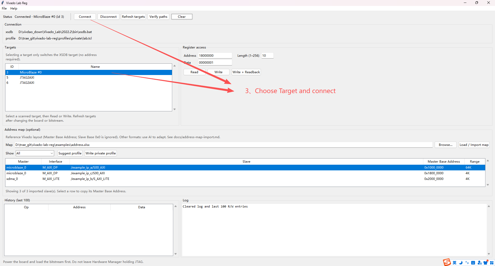
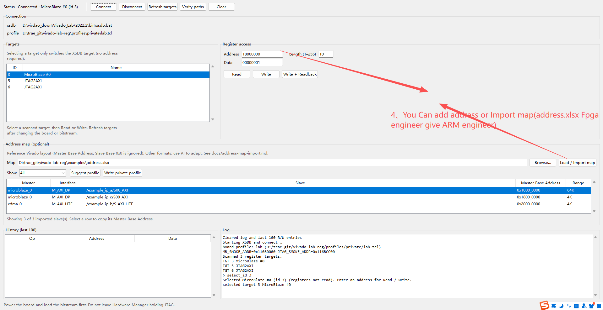
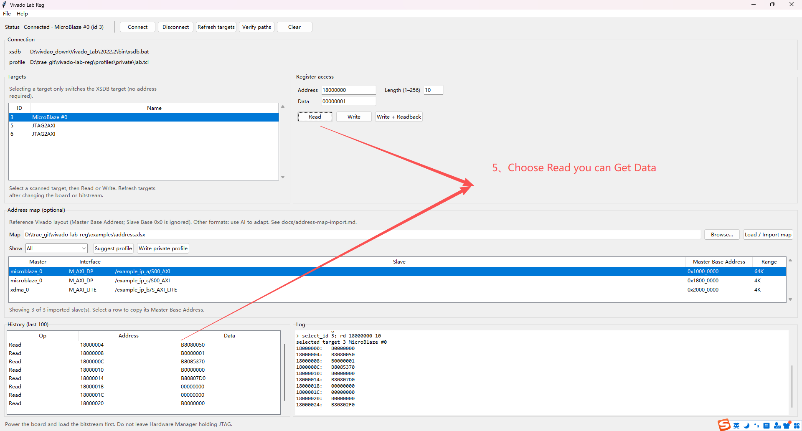

# Windows 图形化寄存器调试工具用法

给 **Ubuntu 上开发、Windows 上连板调试** 用的说明。  
图形界面只在 Windows 上跑；Ubuntu 侧改代码、看 Address Map，把要查的地址拿到这台 Windows 上填进工具即可。

| 项 | 值 |
|----|----|
| 工具目录 | `.` |
| 启动 | 双击 `VivadoLabReg.exe` 或 `gui.cmd` |
| 板卡 | Virtex UltraScale+ FPGA |
| 软件 | Vivado Lab 2022.2 |
| XSDB | `D:\vivdao_down\Vivado_Lab\2022.2\bin\xsdb.bat` |
| 地址表 | 自己的 Address Editor 导出，建议命名 `address.xlsx`（见 [地址表导入](address-map-import.md)）。仓库里的 `examples/address.xlsx` 只是虚构示例 |

---

## 1. 开发时怎么配合

```text
Ubuntu：写 RTL / 驱动 / 看 Address Map，记下要访问的基址
    ↓
Windows：bitstream 下到 FPGA → 打开本 GUI → Connect 扫描 → 在 Targets 里选一行 → 手填地址 → 读/写
```

- **不要**指望在 Ubuntu 上开这个窗口。`gui.py` 调的是 Windows 的 `xsdb.bat` + JTAG 线。
- Ubuntu 上如果也装了 Vivado Lab / Vitis，可以用同目录 `xsdb.sh` 做命令行读写，和 GUI 一样走 `tool.tcl`。
- 新 IP 的地址以工程 **Address Editor** 为准，不要沿用过期示例。
- `smoke` / `verify` 的基址不写在工具里。复制 `profiles/example.tcl` 到 `profiles/private/`，填入 Address Editor 的 **Master Base Address**（不是从机 Slave Base `0x0`），再执行 `xsdb.cmd verify --profile <文件>`。地址为 `0x0` 时该路径的读会跳过。下面各节里的手工读写例子不是工具默认值。

---

## 2. 两条地址空间（先在 Targets 里选对）

同一根 JTAG 上可以有多个 Master，**地址空间不同**。选错 target，读出来是废数据。

点 **Connect** 之后，**Targets** 列出这次扫描到的寄存器 target，每行是 id 和名字（例如 `MicroBlaze #0`、`JTAG2AXI`）。点哪一行，就切到哪个 XSDB target。

```text
GUI / XSDB
    └─ hw_server（JTAG）
           ├─ MicroBlaze     JTAG → XSDB → MDM → MB
           └─ JTAG2AXI       JTAG → XSDB → Jtag Master
```

| 扫描到的 target | 对应 | 用哪套地址 |
|-----------------|------|------------|
| 名字含 MicroBlaze（如 MicroBlaze #0） | MicroBlaze 的 **M_AXI_DP** | 你的 `address.xlsx` 里该 master 的 **Master Base Address** |
| 某一条 JTAG2AXI | Jtag Master | 往往与 **xdma / M_AXI_LITE** 同一窗口；以你的表为准 |
| 另一条 JTAG2AXI | 另一条 Jtag Master | 导出表里常常没有单独的 map，要自己确认 |

在列表里选一行 **只切换 target**，成功即已选中，**还不需要地址**。  
填地址、点 **Read** / **Write**，才是访问寄存器。

列表为空：板上电、下载 bitstream，再点 **Refresh targets**。换板或换 bitstream 之后同样要刷新，再重新选择。

交叉读写的典型错误值：`DEC0DE1C`（AXI 译码失败，地址在这条总线上不存在）。

---

## 3. 启动前检查

1. 板子上电，bitstream 已下载。
2. **关掉** Vivado Hardware Manager（和 GUI 抢同一条 JTAG）。
3. 本机有 Python 3（已用 3.10 验证）和 Vivado Lab。
4. 双击 `VivadoLabReg.exe` 或 `gui.cmd`。**先出现选择 `xsdb.bat` 的设置页**，没选到有效文件就不能进主窗口。浏览从「此电脑」打开，默认文件类型为 `*.bat`。第一次路径为空；点 **Continue** 后写入 `%APPDATA%\VivadoLabReg\config.json`，下次打开自动填入该路径。本机例子：`D:\vivdao_down\Vivado_Lab\2022.2\bin\xsdb.bat`。

---

## 3.1 打成 exe 的前提（打包 / 运行分开）

**打包机（做一次即可）**

- Windows 64 位
- Python 3.10+（含 tkinter）
- `pip install pyinstaller`
- 在 `vivado_lab` 目录执行 `build_exe.bat`

产物：`VivadoLabReg.exe`（已打进 `gui.py` / `gui.tcl` / `tool.tcl` 和 Python 运行时）。

**运行机（日常连板）——不需要 Python**

- Windows 64 位
- **Vivado Lab 或完整 Vivado**（本机是 2022.2，`xsdb.bat` 必须存在）
- 对应版本的 **JTAG 电缆驱动**（装 Lab 时一般已装）
- 板子上电、bitstream 已下载
- **不要**同时开 Hardware Manager
- GUI 记住的 `xsdb.bat` 路径在 `%APPDATA%\VivadoLabReg\config.json`（与 exe 位置无关）

打不开或提示找不到 xsdb：先确认 Lab 已装，并在设置页选择本机的 `xsdb.bat`（例如 `D:\vivdao_down\Vivado_Lab\2022.2\bin\xsdb.bat`）。

重新打包：改完 `gui.py` / `tool.tcl` 后再跑一次 `build_exe.bat`。`tool.tcl` 已打进 exe，只改目录里的 tcl **不会**自动进已生成的 exe。

---

## 4. 窗口怎么用

1. **准备。** 板上电，bitstream 已加载，关掉 Hardware Manager。设置页若还没选过，先指定 `xsdb.bat`（例如 `D:\vivdao_down\Vivado_Lab\2022.2\bin\xsdb.bat`），再点 **Continue**。
2. 点 **Connect**。工具启动 XSDB，并**扫描** JTAG 链。
3. **Targets** 列出扫到的寄存器 target（例如 MicroBlaze #0、JTAG2AXI），每行是 id 和名字，**不是写死的档位**。列表为空：确认上电并已下载 bitstream，再点 **Refresh targets**。
4. **选中**一行。这一步只切换 XSDB target，还不需要填地址。日志会出现 `Selected … (registers not read). Enter an address for Read / Write.`
5. **自己填**，再点 **Read** / **Write** / **Write + Readback**：
   - 地址：十六进制，可带或不带 `0x`，如 `10000000` 或 `0x2000_0000`（虚构示例；真实值来自你的 `address.xlsx`）
   - 长度：连续读几个 32-bit word，默认 `1`，**最大 256**（工具限制；一次读太多会占满历史条数）
   - 数据：写操作用，如 `00000001`
6. 换板或换 bitstream 后，点 **Refresh targets**，再重新选一行。

### 分步截图

和上面的步骤对应。**Connect** / **Targets** 是 JTAG 扫描，不是从 xlsx 自动识别 target。地址表只提供 Master Base Address，选中一行会填进 Address。**Read** / **Write** 用的是选中的 target。



1. 点 **Connect**，扫描 JTAG 链。



2. **Targets** 列出扫到的 target。



3. 选中一行（例如 MicroBlaze #0），切到该 XSDB target。



4. 手填地址，或 **Load / Import map** 导入 `address.xlsx`。选中行把 Master Base Address 填进 Address。



5. 点 **Read**，History 和日志里看到读回数据。

设置页和主窗口都有 **Address map (optional)**。浏览工作簿（建议 `address.xlsx`），点 **Load / Import map** 可看到 Master Base 列表，选中一行会填进地址框。这个 GUI 用的是 **reference** Vivado 布局；别的格式 **请使用 AI 进行适配**，说明在 [地址表导入](address-map-import.md)。**Write private profile** 另存为 profile，默认 `profiles/private/lab.tcl`，覆盖前会询问。路径记在 `%APPDATA%\VivadoLabReg\config.json`。

左侧 **History (last 100)**（新的在上，读/写都会记）；右侧是日志。History 的 Address / Data 显示为 8 位十六进制；XSDB 自己的日志里，短地址仍可能不补前导零。

点历史里的一行，会把该行的地址和数据填回输入框（方便改完再写）。

**Clear**：同时清空日志和历史。不断开 JTAG。  
**Disconnect**：结束 XSDB 会话。

---

## 5. Ubuntu 开发时如何选地址

打开你自己的 `address.xlsx`（或工程里的 Address Editor）。本仓的 [`addr_map.py`](../addr_map.py) 只解析一种参考列布局，示例是虚构的 [`examples/address.xlsx`](../examples/address.xlsx)。**请使用 AI 进行适配**：把 [地址表导入说明](address-map-import.md) 和你的导出一起交给 AI，让它改解析器或生成 profile。不要假设别人的表和示例一样。

```bat
python addr_map.py D:\lab\vivado-lab-reg\examples\address.xlsx
python addr_map.py --xlsx D:\lab\my-design\address.xlsx --path mb
python addr_map.py --xlsx D:\lab\my-design\address.xlsx --suggest-profile
```

### 走 MicroBlaze（Targets 里选 MicroBlaze 那一行）

用 **M_AXI_DP**（或父行名叫 Data）里 **未 Excluded** 的 **Master Base Address**。不要用从机自己的 Slave Base `0x0`，也不要用标了 **Excluded** 的段。

### 走 Jtag Master（Targets 里选对应的 JTAG2AXI）

用和这条 Jtag Master 同一窗口的 **M_AXI_LITE**（很多设计里是 xdma 那一路）。JTAG-to-AXI IP 通常不会作为从机出现在表里，它自己就是 Master。导出表里往往没有第二条 JTAG2AXI 的单独 map，要自己确认。

寄存器偏移：在 Master Base Address 上加 `+0x0 / +0x4 / +0x8 …`（按该 IP 的寄存器手册）。GUI 的「长度」是从该地址起连续几个 word。

工程若重综合导致 Address Map 变了，以 **新的** Address Editor / 新导出的 xlsx 为准。`--suggest-profile` 只是按示例规则挑第一条，警告里会写明；选错就加 `--mb-name` / `--jtag-name`，或改生成的两行 `set`。真实 profile 放在 `profiles/private/`，不要提交。

---

## 6. 对照 Demo（GUI 应与直接 XSDB 一致）

先 **Connect**，在 **Targets** 里选好 target，再填地址。下列为某次 XSDB 实测，计数器类寄存器允许轻微变化。这些数字只是那次会话的对照，不是可复用的地址表；选地址用上一节和虚构示例 `examples/address.xlsx`。

**Demo 1** Targets 里选 MicroBlaze（如 MicroBlaze #0），地址 `11080000`，长度 `8`

| 地址 | 参考值 | 备注 |
|------|--------|------|
| `11080000` | `000F0000` | 较稳 |
| `11080004` | `0000D8C5` | 较稳 |
| `11080008` / `0C` | 会变 | 像计数器 |
| `11080010` | `00000001` | 较稳 |
| `11080014` | `00000001` | 较稳 |
| `11080018` | `00000000` | 较稳 |

**Demo 2** Targets 里选本板对应 `hw_axi_1` 的那条 JTAG2AXI，地址 `116BCC00`，长度 `4`  
`00000000 / 00000001 / 00000001 / 00000000`

**Demo 3** 仍是这一条，地址 `116B0000`，长度 `4`  
`55AA55AA / AA55AA55 / 00000000 / 00000000`

**Demo 4** Targets 里改选另一条 JTAG2AXI（本板对应 `hw_axi_2`），地址 `116BCC00`，长度 `4`  
四个 word 均为 `0000DEAD`（说明切到了另一条 Master）

**Demo 5** 仍停在 Lite 窗那条 JTAG2AXI，地址 `11080000`，长度 `1`  
`DEC0DE1C`（MB 地址拿到 Jtag Master 上，译码失败）

Windows 上重跑 XSDB 基准：

```bat
D:\vivdao_down\Vivado_Lab\2022.2\bin\xsdb.bat .\demo.tcl
```

---

## 7. 读回值怎么判断

| 读回 | 含义 |
|------|------|
| 稳定、符合 IP 手册 | 选中的 target 和地址都对 |
| `DEC0DE1C` | 当前 Master 的总线上 **没有这个地址**（选错 target，或地址不在这条总线上） |
| `0000DEAD` | 某次对照里，另一条 JTAG2AXI 的读回。不要把它当成目标从机的状态 |
| 写显示成功但读回不变 | 只读寄存器，或写没落到从机（再核对选中的 target） |
| 连接失败 / 超时 | 板未上电、未下载 bit、或 Hardware Manager 占着 JTAG |

`WRITE DATA is: …` / 工具里写成功，只表示主机发出了写；**以读回为准**。

---

## 8. Ubuntu 侧没有 GUI 时

同目录命令行与 GUI 走同一套 `mrd` / `mwr`（先关 Hardware Manager）。命令行用 `mb` / `jtag n` 切 target；Windows GUI 在 **Targets** 里点选扫描到的 id。

```bash
cd /path/to/vivado_lab
./xsdb.sh                # 交互，然后 mb / jtag 1 / rd / wr
./xsdb.sh verify --profile /lab/vivado-lab-reg/profiles/private/board.tcl
./xsdb.sh rd  00001000 8
./xsdb.sh jrd 00002000 4
./xsdb.sh jwr 00002008 1
```

不带 `--profile` 时，也可以先 `export VIVADO_LAB_REG_PROFILE=/lab/vivado-lab-reg/profiles/private/board.tcl`（`XSDB_PROFILE` 同样有效）。profile 未设置或地址为 `0x0` 时，`verify` 仍扫描 JTAG，但跳过对应的 smoke 读。

Windows 命令行：`xsdb.cmd` 参数相同。

交互短命令（`tool.tcl`）：

| 命令 | 作用 |
|------|------|
| `xconnect` | 连接并列出路径（命令行） |
| `mb` / `jtag 1` / `jtag 2` | 命令行切到 MicroBlaze，或第 n 条 JTAG2AXI |
| `rd <addr> [len]` | 读 |
| `wr <addr> <data>` | 写 |
| `wrd <addr> <data>` | 写完读回 |

### 8.1 `--json`（给脚本 / Agent）

不加 `--json` 时输出和原来一样。加上之后，stdout 只有一个 JSON 对象，XSDB 横幅走 stderr。`ok` 为 true 退出码 0，否则非 0。参数可以写在子命令前或后。id 来自当次扫描，不要写死。

```bash
./xsdb.sh --json targets
./xsdb.sh --json rd 00001000 1
./xsdb.sh --json wr 00001000 1
./xsdb.sh --json wrd 00001000 1
./xsdb.sh --json jrd 00002000 4
./xsdb.sh --json verify --profile /lab/vivado-lab-reg/profiles/private/board.tcl
```

```bat
xsdb.cmd --json targets
xsdb.cmd --json rd 00001000 4
xsdb.cmd --json wr 00001000 1
```

实验机上先关 Hardware Manager，再上电、下载 bitstream。不连板的检查：`bash tests/test_json_cli.sh`。字段说明和完整示例见仓库 [README.md](../README.md) / [README.zh-CN.md](../README.zh-CN.md) 的「机器可读 JSON」。

`targets` 的 `class` 为 `microblaze` 或 `jtag2axi`。空链也是合法 JSON（`ok` true，`targets` 为 `[]`）。

```json
{
  "ok": true,
  "command": "targets",
  "operation": "targets",
  "error": null,
  "targets": [
    {"id": 3, "name": "MicroBlaze #0", "class": "microblaze"},
    {"id": 5, "name": "JTAG2AXI", "class": "jtag2axi"}
  ]
}
```

读 / 写共用 `ok`、`command`、`operation`、`error`、`target`、`address`、`length`、`data`。`data` 是读回值；纯写时 `data` 是写入内容。`written` 在有写时为写入内容，否则为 `[]`。

```json
{
  "ok": true,
  "command": "rd",
  "operation": "read",
  "error": null,
  "skipped": false,
  "reason": null,
  "target": {"id": 3, "name": "MicroBlaze #0", "class": "microblaze"},
  "address": "0x00001000",
  "length": 1,
  "data": ["0x00000001"],
  "written": []
}
```

`verify` 的 `results` 里每一项都是这种读结果（`command` 为 `smoke` 或 `jsmoke`）。地址为 `0x0` 时 `skipped` 为 true，不发 `mrd`。

---

## 9. 目录文件

| 文件 | 用途 |
|------|------|
| **本文档** | Ubuntu 开发时对照、Windows 上操作 GUI |
| `VivadoLabReg.exe` | Windows 图形界面（不需要 Python） |
| `build_exe.bat` | 重新打包 exe |
| `gui.cmd` `gui.py` `gui.tcl` | 源码启动 / 开发调试 |
| `tool.tcl` | 真正的 `mrd`/`mwr` 逻辑 |
| `xsdb.cmd` / `xsdb.sh` | Windows / Linux 命令行 |
| `demo.tcl` | 与 GUI 对照的 XSDB 基准 |
| `examples/address.xlsx` | 虚构的 Address Map 示例（参考列）。真实导出不要提交 |
| `reg.tcl` | `verify` 批处理 |

---

## 10. 本机 JTAG 链（编号会变，以当次扫描为准）

下面是某次 Virtex UltraScale+ 扫描的例子。下次连接，id 可能不同。**Targets** 显示的就是当次扫到的 id 和名字。

```text
1  Virtex UltraScale+ FPGA
   2  MicroBlaze Debug Module at USER2
      3  MicroBlaze #0     ← 会出现在 Targets
   4  Legacy Debug Hub
      5  JTAG2AXI          ← 会出现在 Targets
      6  JTAG2AXI          ← 另一条，单独成行
```

**Targets** 收录能做寄存器读写的 MicroBlaze 和 JTAG2AXI（Jtag Master）。点一行即选中该 id。不要把 target 编号写死进脚本；换板或换 bitstream 后点 **Refresh targets** 再选。
